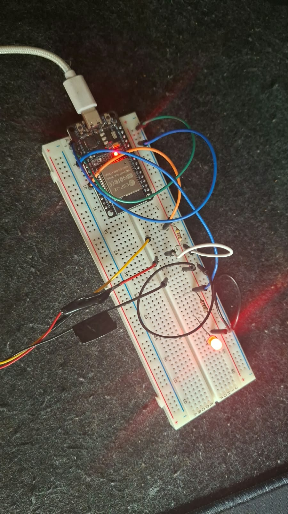

# Entrega 5 — Persistência em Banco Chave-Valor (Gateway MQTT → Redis)

**Disciplina:** Internet das Coisas III (IoT III)
**Instituição:** IFMG — Campus Ouro Branco
**Projeto:** Cadeia Fria IoT — Monitoramento com ESP32
**Autor:** Rodolfo Miranda
**Data:** 12/10/2026


## 1. Resumo

Foi implementado um gateway em Node.js que atua como cliente MQTT, recebe as mensagens publicadas pelo ESP32 no broker, valida o conteúdo JSON e persiste os dados em um banco Redis. O Redis armazena, para cada dispositivo, o **estado atual**, o **histórico de telemetria**, a **presença/último contato** e uma **trilha de auditoria de comandos e confirmações**. Uma ferramenta de linha de comando (`query.js`) permite consultar os dados persistidos.

Como a Entrega 4 (gateway MQTT) não foi entregue separadamente, seus requisitos — conexão ao broker, assinatura de tópicos, identificação do dispositivo, validação de JSON e registro de mensagens válidas/inválidas — foram implementados nesta etapa e estão resumidos na Seção 3.

Todos os testes foram executados com o **ESP32 real** (`esp32cadeiafria`) publicando no broker público `broker.hivemq.com:1883`.


## 2. Arquitetura

```
┌──────────────┐  MQTT (Wi-Fi)  ┌─────────────────────┐  MQTT  ┌────────────────────┐  RESP  ┌─────────┐
│ ESP32        │ ─────────────▶ │ broker.hivemq.com   │ ─────▶ │ Gateway Node.js    │ ─────▶ │ Redis 7 │
│ DS18B20 + LED│ ◀───────────── │ :1883               │        │ validação + store  │        │ (Docker)│
└──────────────┘    command     └─────────────────────┘        └────────────────────┘        └─────────┘
                                                                         ▲
                                                               query.js (consultas)
```

| Componente | Tecnologia | Função |
|---|---|---|
| Dispositivo | ESP32 + DS18B20 (GPIO 19) + LED (GPIO 4) | Mede temperatura, aciona alarme, publica telemetria/estado, recebe comandos |
| Broker | HiveMQ público, porta 1883 | Intermediação publish/subscribe |
| Gateway | Node.js 18+, bibliotecas `mqtt` e `redis` | Assina tópicos, valida, persiste |
| Banco | Redis 7 em container Docker | Armazenamento chave-valor |

### 2.1 Organização do código

| Arquivo | Responsabilidade |
|---|---|
| `gateway.js` | Conexão MQTT, roteamento por tipo de tópico, logs de diagnóstico |
| `validator.js` | Interpretação do tópico e validação do payload por tipo de mensagem |
| `store.js` | Escrita e leitura no Redis |
| `query.js` | CLI de consulta (estado, histórico, janela de tempo, comandos, logs) |
| `config.js` | Parâmetros via variáveis de ambiente (`MQTT_URL`, `REDIS_URL`, `HISTORY_MAX`, `PRESENCE_TTL`) |
| `KEYS.md` | Documentação do modelo de chaves |

A separação entre validação, persistência e transporte permite testar cada parte isoladamente e trocar o banco ou o broker sem reescrever o restante.


## 3. Gateway MQTT (requisitos da Entrega 4)

### 3.1 Conexão e assinatura

| Parâmetro | Valor | Justificativa |
|---|---|---|
| Tópico assinado | `ifmg/iot3/2026-1/rodolfo/+/#` | O curinga `+` no nível do dispositivo permite atender N ESP32 sem alterar o código |
| QoS da assinatura | 1 | Comandos e confirmações não podem ser perdidos |
| `clientId` | `gw-cadeiafria-<aleatório>` | Evita colisão com outras instâncias no broker público |
| Reconexão | Automática, a cada 5 s | O gateway se recupera sozinho de quedas do broker |

### 3.2 Identificação do dispositivo

O `deviceId` é extraído do **quinto nível do tópico** (`ifmg/iot3/<turma>/<aluno>/<deviceId>/<tipo>`). Nas mensagens de telemetria e estado, o gateway também confere se o campo `deviceId` do payload coincide com o do tópico; se divergir, a mensagem é rejeitada. Isso impede que um publicador grave dados em nome de outro dispositivo por engano.

### 3.3 Validação das mensagens

| Tipo de tópico | Regras aplicadas |
|---|---|
| `telemetry` | JSON objeto; `sensor = "temperatura"`; `value` numérico **ou `null`** (falha de leitura definida na Entrega 3); faixa física do DS18B20 (−55 a 125 °C); `unit = "C"`; `sequence` e `uptimeMs` inteiros ≥ 0; `armed` e `ledOn` booleanos |
| `state` | `actuator` ∈ {`alarm`, `led`}; `state` booleano |
| `command` | `action = "set"`; `target` ∈ {`alarm`, `led`}; `value` booleano |
| `availability` | Texto puro `online` ou `offline` |
| Qualquer | Tópico fora do padrão ou tipo desconhecido é rejeitado |

Mensagens inválidas **não** alteram estado nem histórico: são registradas no log do terminal e na lista `cadeiafria:log:invalid`, com o payload original e a lista de erros, para diagnóstico.


## 4. Modelagem das chaves no Redis

Padrão adotado: `cadeiafria:device:<deviceId>:<aspecto>`. O prefixo `cadeiafria:` funciona como *namespace* do projeto; o `<deviceId>` distingue cada dispositivo.

| Chave | Tipo | Conteúdo | Retenção |
|---|---|---|---|
| `cadeiafria:devices` | SET | Índice de dispositivos conhecidos | Permanente |
| `cadeiafria:device:<id>:state` | HASH | **Estado atual**: temperatura, `sensorOk`, `armed`, `ledOn`, `sequence`, `uptimeMs`, `wifiRssi`, `lastTelemetryAt`, `lastRequestId` | Sobrescrito |
| `cadeiafria:device:<id>:telemetry` | ZSET | **Histórico**: JSON de cada leitura; *score* = instante de recepção (epoch ms) | Últimas 10.000 |
| `cadeiafria:device:<id>:presence` | HASH | **Presença**: `status` (online/offline), `statusChangedAt`, `lastSeen` (último contato) | Sobrescrito |
| `cadeiafria:device:<id>:alive` | STRING + TTL | *Heartbeat*: expira 60 s após o último contato | TTL |
| `cadeiafria:device:<id>:commands` | LIST | Auditoria de comandos e confirmações | Últimas 200 |
| `cadeiafria:log:valid` / `:log:invalid` | LIST | Diagnóstico do gateway | Últimas 500 |

### 4.1 Decisões de modelagem e alternativas

| Decisão | Alternativa considerada | Motivo da escolha |
|---|---|---|
| **HASH** para estado atual | STRING com JSON | Leitura/escrita de um campo isolado (`HGET ... armed`) sem desserializar o objeto inteiro |
| **ZSET** para histórico | LIST (`LPUSH`) | O *score* temporal permite consulta por **janela de tempo** (`ZRANGEBYSCORE`), essencial para responder "a temperatura saiu da faixa entre 14h e 15h?". LIST só permite acesso por posição. Custo: mais memória por elemento |
| ZSET para histórico | Redis Streams (`XADD`) | Streams também são temporais e idiomáticos para eventos; ZSET foi escolhido pela simplicidade de consulta. Streams seriam a evolução natural com múltiplos consumidores |
| **Duas fontes de presença** (LWT + TTL) | Apenas LWT | O LWT chega com atraso (≈1,5 × keepalive) e pode chegar **fora de ordem** (ver Seção 6.2). O TTL é uma verificação independente. O dispositivo só é considerado alcançável se ambas concordarem |
| Comando **não** atualiza `lastSeen` | Contar qualquer mensagem no tópico | O comando é publicado por terceiros; contá-lo como contato mascararia um ESP32 desligado |
| Escrita atômica (`MULTI/EXEC`) | Comandos independentes | Estado, histórico e presença de uma mensagem são gravados juntos — nunca há estado novo com histórico antigo |
| Retenção limitada (`ZREMRANGEBYRANK`, `LTRIM`) | Crescimento ilimitado | Evita esgotar a memória do Redis em operação contínua |


## 5. Persistência implementada

| Mensagem recebida | Efeito no Redis |
|---|---|
| `telemetry` | Atualiza `state`; adiciona leitura ao ZSET `telemetry`; atualiza `presence.lastSeen`, marca `status=online` e renova `alive` |
| `state` | Atualiza `armed` ou `ledOn` no `state` (confirmação do ESP32 é a fonte de verdade do atuador); registra em `commands`; atualiza presença |
| `command` | Registra em `commands` (sem alterar presença) |
| `availability` | Atualiza `presence.status`; `offline` remove a chave `alive` imediatamente |

### 5.1 Consultas disponíveis

```bash
npm run query -- devices                       # dispositivos conhecidos
npm run query -- state    esp32cadeiafria      # estado atual + presença
npm run query -- history  esp32cadeiafria 20   # últimas N leituras
npm run query -- window   esp32cadeiafria 15   # leituras dos últimos N minutos (min/máx/média)
npm run query -- commands esp32cadeiafria 6    # auditoria comando → confirmação
npm run query -- invalid  3                    # últimas mensagens rejeitadas
```


## 6. Evidências

Logs completos anexados: `evidencia_gateway.log` (terminal do gateway, 15:57–16:15 UTC) e `evidencia_consultas.log` (todas as consultas, em ordem de execução).

### 6.1 Persistência e recuperação

| Evidência | Onde | Resultado |
|---|---|---|
| Gateway conectado ao broker e ao Redis | `evidencia_gateway.log`, linhas iniciais | `[redis] conectado`, `[mqtt] assinado: ifmg/iot3/2026-1/rodolfo/+/#` |
| Recepção contínua de telemetria | `evidencia_gateway.log` | 66 telemetrias válidas, `sequence` sem lacunas |
| Estado atual persistido | `evidencia_consultas.log`, seção 2 | `armed=false`, `lastRequestId=e5-01` logo após o comando |
| Histórico persistido | Seção 1 e 6 | 104 leituras na consulta; 130 no `ZCARD` alguns minutos depois |
| Consulta por janela de tempo | Seção 7 | 53 leituras em 15 min (min 4,31 / máx 19,88 / média 11,11 °C) |
| Chaves no Redis conferem com o modelo | Seção 6 (`redis-cli --scan`) | As 8 chaves da Seção 4 presentes |

**Verificação de integridade do histórico:** com uma leitura a cada ≈15,75 s, 15 minutos produzem ≈57 leituras; descontado o intervalo de ≈1,5 min em que o ESP32 ficou desligado (≈6 leituras), esperam-se ≈51–53. As 53 registradas indicam ausência de perdas.

### 6.2 Comando → confirmação → persistência

```
16:04:48.783  command alarm=false req=e5-01
16:04:49.015  state   alarm=false req=e5-01      (~230 ms)
16:04:49.318  telemetry T=12.75°C armed=false led=false
```

| Ciclo | Comando | Confirmação | Efeito observado |
|---|---|---|---|
| e5-01 | Desarmar alarme | `state alarm=false` | LED apaga mesmo a 12,75 °C (fora da faixa) |
| e5-02 | LED manual ligado | `state led=true` | LED aceso com alarme desarmado |
| e5-03 | Rearmar alarme | `state alarm=true` | LED volta ao controle automático (aceso a 12,94 °C) |

A consulta `commands` (seção 4 do log) mostra os seis registros em ordem, cada confirmação pareada ao comando pelo `requestId`.

### 6.3 Presença e último contato

| Instante (UTC) | Evento | Fonte |
|---|---|---|
| 16:10:19 | Última telemetria (`seq=72`) | `lastSeen` |
| 16:11:17 | `availability=offline` publicado pelo broker (LWT) | Gateway |
| (consulta) | `status=offline`, `heartbeatTtl=-2`, `reachable=false` | Redis, seção 5a |
| 16:11:42 | `availability=online` após religar | Gateway |
| 16:11:52 | `seq=0`, `uptimeMs=15777` | Reinício real do ESP32 |

O LWT chegou ≈58 s após a última telemetria, coerente com o keepalive de 30 s × 1,5. Durante o período offline, `lastSeen` permaneceu fixo, cumprindo o requisito de registro do último contato.

**Caso observado durante os testes — LWT fora de ordem:** ao regravar o firmware, a sessão MQTT anterior expirou *depois* que a nova sessão já havia publicado `online`. O broker entregou o `offline` atrasado e o dispositivo aparecia como offline enquanto enviava telemetria normalmente. A correção foi tratar qualquer telemetria ou confirmação recebida como prova de presença (`status=online`). O episódio justifica, na prática, a decisão de não depender apenas do LWT (Seção 4.1).

### 6.4 Validação de mensagens inválidas

| Payload | Tópico | Erro registrado |
|---|---|---|
| `{quebrado` (teste proposital) | `telemetry` | JSON malformado |
| `{\"action\":...}` (aspas escapadas pelo PowerShell) | `command` | JSON malformado |

O segundo caso ocorreu de forma não intencional, durante os testes, e demonstra o gateway rejeitando um payload real mal formatado. Nenhuma das duas mensagens alterou estado ou histórico.

### 6.5 Acionamento físico



*Figura 1 — ESP32 com DS18B20 e LED de alarme aceso, com temperatura fora da faixa e alarme armado.*


## 7. Configuração de temperatura

Durante os testes, a faixa segura no firmware foi configurada em **0 a 10 °C** para facilitar a demonstração em bancada. Por isso, nos logs, o LED permanece apagado a 8,88 °C e 9,69 °C e acende a 10,38 °C — comportamento correto para essa configuração.

A faixa de referência para vacinas refrigeradas é **2 a 8 °C** (adotada na Entrega 3). Em operação real, o limite inferior de 0 °C seria inadequado, pois muitas vacinas perdem eficácia por congelamento antes de o alarme disparar. O gateway e o Redis independem da faixa: armazenam o `ledOn` informado pelo dispositivo.


## 8. Limitações e próximos passos

| Limitação | Impacto | Melhoria proposta |
|---|---|---|
| Broker público sem TLS/autenticação | Qualquer cliente pode publicar nos tópicos; a validação barra dados malformados, mas não falsificação | Mosquitto próprio com usuário/senha e TLS |
| Timestamp do histórico é o de **recepção** no gateway | Atrasos de rede deslocam o horário; leituras feitas offline não são registradas | NTP no ESP32 e campo `ts` no payload |
| QoS 1 pode entregar duplicatas | Possível leitura duplicada no histórico | Deduplicação por `deviceId` + `sequence` |
| Redis sem persistência configurada em disco | Dados perdidos se o container for removido | Habilitar AOF (`--appendonly yes`) e volume Docker |
| Consulta apenas via CLI | Sem visualização gráfica | Dashboard consumindo o Redis |


## 9. Como reproduzir

```powershell
docker run -d --name redis -p 6379:6379 redis:7
cd gateway
npm install
npm start                                     # terminal 1
npm run query -- state esp32cadeiafria        # terminal 2
```

Envio de comandos (arquivos em `cmds/`, evitando problemas de aspas no PowerShell):

```powershell
$T = "ifmg/iot3/2026-1/rodolfo/esp32cadeiafria"
mosquitto_pub -h broker.hivemq.com -t "$T/command" -f cmds\desarmar.json
```


## 10. Anexos

| Arquivo | Conteúdo |
|---|---|
| `gateway/` | Código-fonte do gateway (`gateway.js`, `validator.js`, `store.js`, `query.js`, `config.js`) |
| `gateway/KEYS.md` | Documentação do modelo de chaves |
| `gateway/evidencia_gateway.log` | Log do gateway com o ESP32 real |
| `gateway/evidencia_consultas.log` | Consultas ao Redis |
| `firmware/CadeiaFria_MQTT/CadeiaFria_MQTT.ino` | Firmware do ESP32 |
| `led_on.jpeg` | Foto do circuito com LED aceso |
